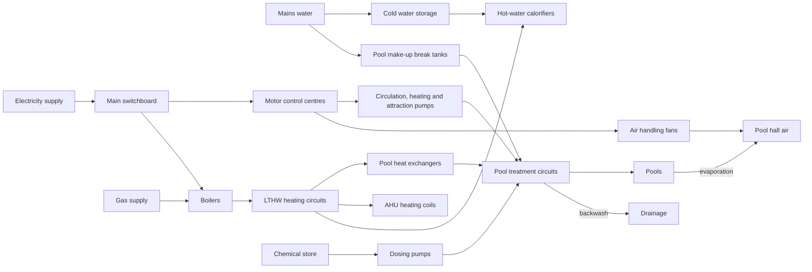
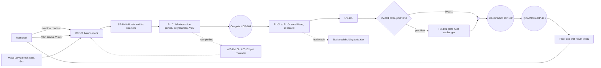
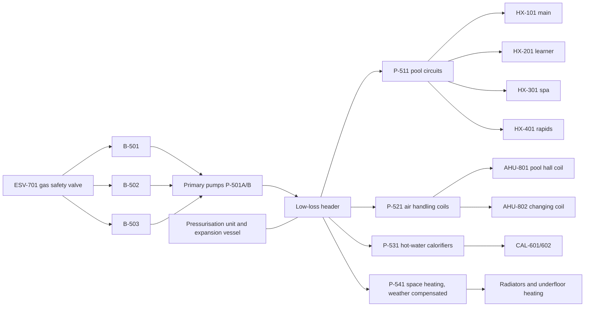
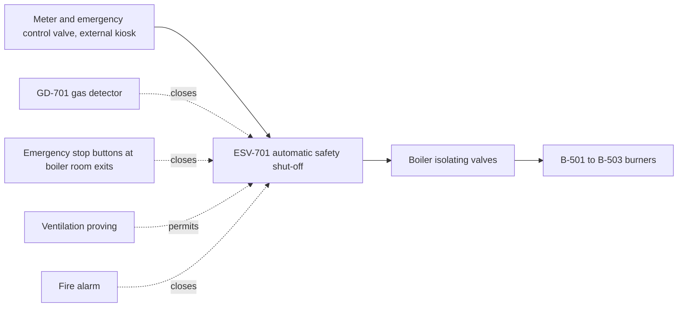
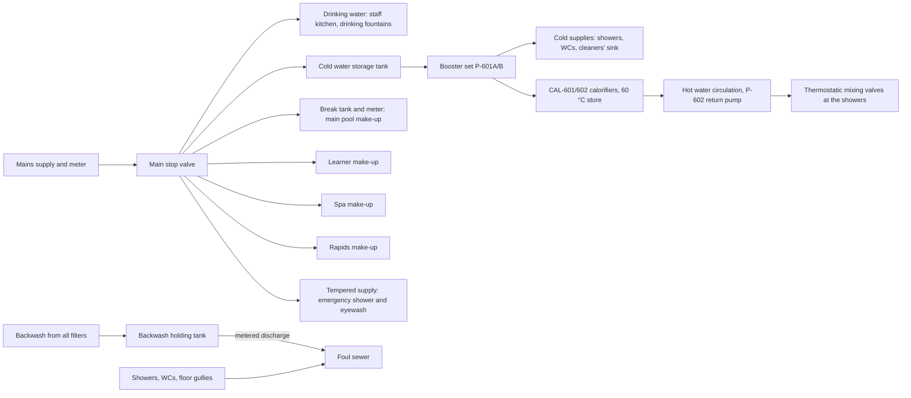
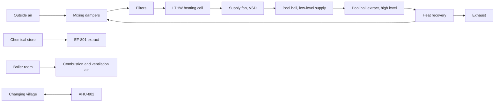
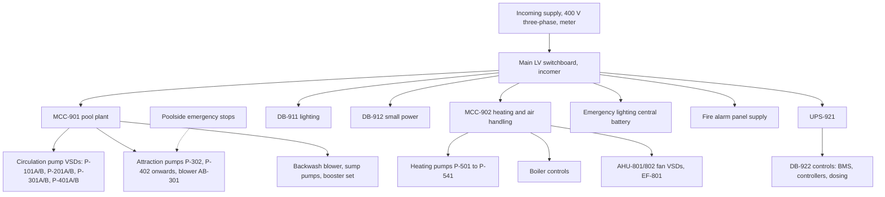

# Plant systems and how they connect

A first plan of the building's engineering systems: what each circuit contains, how the circuits feed one another, which room each piece of equipment sits in, and which signals and interlocks join them. It is written to become the simulation's topology, so every item has a stable tag that the simulation, the schematic and the 3D rooms will share.

This is a planning draft from general UK pool-plant practice (PWTAG's _Swimming Pool Water_, HSG179, Sport England's servicing guidance). Figures are working estimates. Each equipment family still needs a referenced product and its manual before it is modelled, as the project brief requires.

## Contents

1. [Tags](#tags)
2. [The systems at a glance](#the-systems-at-a-glance)
3. [Pool water treatment circuits](#pool-water-treatment-circuits)
4. [Attraction circuits](#attraction-circuits)
5. [Heating (LTHW)](#heating-lthw)
6. [Gas](#gas)
7. [Mains water, hot water and drainage](#mains-water-hot-water-and-drainage)
8. [Air handling](#air-handling)
9. [Electrical distribution](#electrical-distribution)
10. [Controls, signals and interlocks](#controls-signals-and-interlocks)
11. [What depends on what](#what-depends-on-what)
12. [Where it runs](#where-it-runs)
13. [The first slice to simulate](#the-first-slice-to-simulate)
14. [Open questions](#open-questions)

## Tags

Tags follow process-plant practice: a letter code for the kind of thing, then a three-digit number whose hundreds digit names the system.

| Series | System                                          |
| ------ | ----------------------------------------------- |
| 1xx    | Main pool treatment                             |
| 2xx    | Learner pool treatment                          |
| 3xx    | Spa pool treatment and its attraction equipment |
| 4xx    | Rapids ride treatment and attraction pumps      |
| 5xx    | Heating (LTHW: low-temperature hot water)       |
| 6xx    | Mains water, hot water and drainage             |
| 7xx    | Gas                                             |
| 8xx    | Air handling and ventilation                    |
| 9xx    | Electrical distribution                         |

| Code           | Kind                                           | Code | Kind                         |
| -------------- | ---------------------------------------------- | ---- | ---------------------------- |
| BT             | Balance tank                                   | P    | Pump                         |
| ST             | Strainer                                       | F    | Filter                       |
| UV             | UV unit                                        | HX   | Plate heat exchanger         |
| DP             | Dosing pump                                    | CT   | Chemical bulk tank           |
| V              | Valve (manual)                                 | CV   | Control valve                |
| B              | Boiler                                         | CAL  | Hot-water calorifier         |
| AHU            | Air handling unit                              | EF   | Extract fan                  |
| FT, PT, TT, LT | Flow, pressure, temperature, level transmitter | AIT  | Analyser (free chlorine, pH) |
| PDT            | Differential pressure transmitter              | GD   | Gas detector                 |
| MCC            | Motor control centre                           | DB   | Distribution board           |
| VSD            | Variable-speed drive                           | ESV  | Gas safety shut-off valve    |

So `P-101A` and `P-101B` are the main pool's duty and standby circulation pumps, `F-101` to `F-104` its sand filters, and `TT-101` the temperature transmitter on its return.

## The systems at a glance

Electricity is the root of everything: without it nothing circulates, heats, doses or ventilates. Gas only matters through the boilers. Mains water only matters slowly, through make-up and hot water.

## Pool water treatment circuits

Each pool has its own circuit: main, learner, spa and rapids are separate water bodies with their own balance tank, pumps and filters. PWTAG treats separate treatment as normal, and as essential for a spa, whose small hot volume and heavy bather load need a much faster turnover.

### The main pool circuit (1xx), in flow order

- **Overflow and drains.** A deck-level pool overflows continuously into a perimeter channel that drains by gravity to the balance tank, which therefore sits below pool water level: the lower plant level. Main drains in the pool floor also run to the tank, through a valve that sets the share of flow drawn from the floor.
- **Balance tank.** It absorbs the water displaced by bathers and the waves they make. Its level (`LT-101`) drives the make-up valve and protects the pumps: low level trips them before they run dry.
- **Pumps.** Duty and standby, each with a strainer basket ahead of it. A variable-speed drive holds the flow (`FT-101`) at setpoint as the filters load. A pump that is commanded to run is not proven running until the flow switch and drive feedback say so.
- **Filters.** Pressure sand filters in parallel. As they load with dirt, the pressure difference across them (`PDT-101`) rises and the flow falls unless the pump works harder. Past a limit the filter is backwashed: flow is reversed through it, with an air scour first, and sent to waste. This is the brief's first fault scenario.
- **UV.** After the filters, it breaks down chloramines (combined chlorine, which gives the "chlorine smell"). It needs a minimum flow and runs only while the circuit does.
- **Heating.** A three-port control valve sends part of the flow through the plate heat exchanger, whose hot side is the LTHW circuit from the boiler room. The pool's temperature (`TT-101`, on the return from the pool) positions the valve. With no flow or no LTHW the pool cools slowly, by evaporation and through the shell: the brief's second fault scenario.
- **Dosing.** pH correction, then hypochlorite, injected after the heater into the return. The controller samples water from the circuit before the dosing points and doses to hold free chlorine and pH. A biased or stuck sensor here is the brief's third fault scenario.

Working sizes:

| Circuit                                         | Volume                    | Turnover | Flow           | Filters at about 25 m/h |
| ----------------------------------------------- | ------------------------- | -------- | -------------- | ----------------------- |
| Main pool (50 × 20 × 1.8 m in the current plan) | about 1,800 m³            | 3 h      | about 600 m³/h | 4 × 2.8 m diameter      |
| Learner pool                                    | about 80 m³               | 1 h      | about 80 m³/h  | 1 × 2.0 m diameter      |
| Spa (if 3 m across)                             | about 6 m³                | 10 min   | about 36 m³/h  | 1 × 1.4 m diameter      |
| Rapids channel                                  | to be sized with the ride | 1 h      | to be sized    | to be sized             |

### The learner, spa and rapids circuits (2xx, 3xx, 4xx)

The same arrangement, smaller. The spa runs hotter (about 37 °C against about 29 °C for the main pool), so its heat exchanger is relatively larger and its controls tighter. PWTAG also expects a spa to be drained and refilled regularly, so its make-up and drain-down connections matter more.

## Attraction circuits

The spa's jets and air blower and the rapids ride's pumps move water for effect, not for treatment. They are separate circuits that draw from and return to the pool body itself, and must not be confused with the treatment flow.

- **Spa (3xx).** Jet pump `P-302` (pool suction to wall jets), air blower `AB-301` (bubbles through a floor grid), both on a timer button at poolside and both stopped by the spa's emergency stop.
- **Rapids (4xx).** Several large attraction pumps `P-402` onwards, drawing from suction grilles at the channel's downstream end and returning through jets that drive the current. These are the largest motors in the building, started in sequence, each with an anti-entrapment arrangement (dual suction or vacuum-release protection) and all stopped together by the ride's emergency stops and by the lifeguard's console.

## Heating (LTHW)

- Two or three modular condensing gas boilers, sequenced by the flow temperature on the header. More than one gives redundancy: losing one boiler slows heating instead of stopping it.
- A low-loss header separates the boiler pumps from the secondary circuits, so each secondary circuit can start and stop without upsetting the boilers.
- Secondary circuits, each with its own pump, serve the pool heat exchangers, the air handling coils, the hot-water calorifiers and the space heating.
- The pressurisation unit holds the system pressure. Losing it, or a leak, drops pressure until the boilers lock out on low pressure: a heating-supply failure with its own cause.
- A modern building might replace or supplement the boilers with a heat pump or CHP, and recover heat from the pool hall's extract air. That is a later choice and does not change the circuit's shape.

## Gas

The only gas user is the boiler room. The safety shut-off valve opens only while its permissives hold: no gas detected, ventilation proven, no emergency stop pressed, no fire alarm. It then stays shut until someone resets it locally. This gives a heating failure whose cause is in another system: a fire alarm or a ventilation fault shuts the gas, the boilers stop, and the pools cool.

## Mains water, hot water and drainage

- **Make-up.** Pool water may not connect directly to the mains. Each pool's make-up passes through a break tank with an air gap (UK water regulations), then a meter, so the plant can show how much fresh water each pool has had. PWTAG asks for dilution of about 30 litres per bather, which links bather numbers to water use.
- **Hot water.** Showers are the large demand. Calorifiers store at 60 °C and circulate at not less than 50 °C to control legionella; mixing valves at the showers bring it down to a safe temperature.
- **Drainage.** Backwash water goes to a holding tank and is let out to the sewer at a controlled rate, because a backwash's flow exceeds what a sewer connection is allowed to take. The chemical store's bunds have no drain: a spill is held, never sent to the sewer.

## Air handling

- The pool hall unit (`AHU-801`) keeps the hall air about 1 °C above the water temperature and at 50–60 % relative humidity. Warm, dry air slows evaporation from the pools, so the air handling and the pool heating are coupled: if the hall air goes cold or damp, the pools lose heat faster and condensation forms.
- Dehumidification is by bringing in drier outside air (or by a heat pump), with heat recovered from the extract air.
- The chemical store has its own extract fan, interlocked so the store is ventilated before anyone enters and so gas detection alarms it.

## Electrical distribution

- Each motor has its starter or drive, an overload or drive protection, and an isolator at the motor. These are the encabulator's MCC buckets, contactors, overload relays and drives, now driving real equipment.
- Control power, the building management system and the dosing controllers sit behind a UPS, so a short supply dip does not lose the controls' state. Dosing, however, must stop when circulation stops, whatever the UPS keeps alive.
- A supply failure stops everything that circulates. On return, pumps restart in sequence, not all at once, and attraction pumps stay off until a person restarts them.

## Controls, signals and interlocks

The interlocks are where systems meet. Each one below is a candidate for the simulation, because each makes one system's state the cause of another's behaviour.

| Interlock                 | Condition                                          | Effect                                                   | Why it matters                                                                                                                   |
| ------------------------- | -------------------------------------------------- | -------------------------------------------------------- | -------------------------------------------------------------------------------------------------------------------------------- |
| Dosing permissive         | Circulation flow proven (`FT-101` above minimum)   | Hypochlorite and acid dosing pumps may run               | Dosing into still water lets hypochlorite and acid meet in the pipework and release chlorine gas. PWTAG requires this interlock. |
| Dry-run protection        | Balance tank level (`LT-101`) above low-low        | Circulation pumps may run                                | Protects the pumps' seals.                                                                                                       |
| Make-up control           | Balance tank level below normal                    | Make-up valve opens                                      | Keeps the tank in range as water is lost to evaporation, splash and backwash.                                                    |
| UV permissive             | Flow proven                                        | UV lamps energised                                       | Lamps overheat without flow.                                                                                                     |
| Heat exchanger permissive | Flow proven                                        | Pool heating valve may open, pool heating pump may run   | Hot, still water in the exchanger scales it.                                                                                     |
| Backwash sequence         | Selected filter isolated, backwash tank has room   | Air scour, then reverse flow, then rinse                 | A backwash with a full tank floods the plant room.                                                                               |
| Gas safety                | No gas, ventilation proven, no stop, no fire alarm | Gas safety valve may open                                | See [Gas](#gas).                                                                                                                 |
| Boiler permissive         | System pressure in range, flow proven              | Burners may fire                                         |                                                                                                                                  |
| Attraction stop           | Emergency stop circuit healthy                     | Spa and rapids attraction pumps may run                  | Bather safety.                                                                                                                   |
| Fire alarm                | Alarm active                                       | Gas off, air handling to fire mode, attraction pumps off | Cross-system shutdown on one signal.                                                                                             |
| Chemical store entry      | Extract fan proven, no gas detected                | Door access permitted, alarm clear                       |                                                                                                                                  |

Control loops:

| Loop                  | Measured                         | Manipulated                        |
| --------------------- | -------------------------------- | ---------------------------------- |
| Pool temperature      | `TT-101` pool return temperature | `CV-101` heat exchanger valve      |
| Free chlorine         | `AIT-101`                        | `DP-101` hypochlorite dosing rate  |
| pH                    | `AIT-102`                        | `DP-102` acid dosing rate          |
| Circulation flow      | `FT-101`                         | `P-101` drive speed                |
| Balance tank level    | `LT-101`                         | Make-up valve                      |
| LTHW flow temperature | Header temperature               | Boiler sequencing and firing rate  |
| Hall air              | Hall temperature and humidity    | AHU coil valve, dampers, fan speed |

Every measured value above is an instrument, separate from the true value in the simulation: it can lag, drift, read biased or stick, as the brief requires.

## What depends on what

Read across: the row's system needs the column's system to work.

| Needs →                         | Electricity | Gas                | Mains water      | LTHW | Circulation | Air handling                          | Controls           |
| ------------------------------- | ----------- | ------------------ | ---------------- | ---- | ----------- | ------------------------------------- | ------------------ |
| Pool circulation and filtration | yes         |                    | slowly (make-up) |      |             |                                       | yes                |
| Pool heating                    | yes         | yes                |                  | yes  | yes         | indirectly (evaporation)              | yes                |
| Disinfection and pH             | yes         |                    |                  |      | yes         |                                       | yes                |
| LTHW                            | yes         | yes                | slowly (refill)  |      |             | yes (boiler room ventilation proving) | yes                |
| Hot water for showers           | yes         | yes                | yes              | yes  |             |                                       |                    |
| Pool hall air                   | yes         | yes (via the coil) |                  | yes  |             |                                       | yes                |
| Attraction pumps                | yes         |                    |                  |      |             |                                       | yes (stop circuit) |

The chain the brief's "Pool 01 feels cold" report follows can now be traced: a cold pool can come from the pool's temperature sensor, the heat exchanger valve, lost circulation (filters, pumps, balance tank), the LTHW circuit pump, the boilers, their pressurisation, the gas safety valve, or a fire alarm or ventilation fault upstream of that, or from cold, damp hall air speeding evaporation. Each has different evidence in different rooms.

## Where it runs

Against the current plan in `src/game/facility-plan.ts`:

| Room                             | Equipment                                                                                                                                                                                                      |
| -------------------------------- | -------------------------------------------------------------------------------------------------------------------------------------------------------------------------------------------------------------- |
| Main Pool Hall                   | The pools, overflow channels, main drains, return inlets, spa and rapids attraction outlets, poolside emergency stops, hall temperature and humidity sensors, low-level supply and high-level extract grilles  |
| Balance Tank Room (lower)        | `BT-101` to `BT-401`, make-up break tanks and meters, level transmitters, main drain valves                                                                                                                    |
| Pump and Filtration Room (lower) | Strainers, circulation pumps and drives' motors, sand filters and their valve sets, backwash blower, UV units, plate heat exchangers and their control valves, flow meters, dosing injection points, sump pump |
| Lower Plant Landing (lower)      | Pipe routes between the two lower rooms and the riser up to ground level; backwash holding tank if it does not fit elsewhere                                                                                   |
| Upper Plant Room                 | Proposed dosing room: dosing pumps, chlorine and pH controllers and their sample cells. It sits beside the chemical store and above the injection points.                                                      |
| Chemical Store                   | Bunded hypochlorite and acid tanks in separate compartments, external fill points, extract fan, gas detection, emergency shower and eyewash                                                                    |
| Boiler Room                      | Boilers, flues, gas safety valve and detection, primary and secondary pumps, low-loss header, pressurisation unit, calorifiers                                                                                 |
| Air Handling Plant               | `AHU-801`, `AHU-802`, heat recovery, ductwork risers, cold water storage and booster set if housed here                                                                                                        |
| Electrical Switch Room           | Incoming supply, main switchboard, `MCC-901`, `MCC-902`, distribution boards, UPS, emergency lighting battery                                                                                                  |
| Plant Control Centre             | Building management system workstation, the operator schematic, alarm annunciator, pool CCTV                                                                                                                   |
| Duty Manager's Office            | Water test kits, plant logbook, operating procedures                                                                                                                                                           |
| Reception                        | Fire alarm panel, the main point of call for alarms                                                                                                                                                            |

Pipe and cable routes the rooms imply:

- Pool hall down to the Balance Tank Room: overflow and main drain lines, by gravity.
- Pump room back up to the pool hall: return lines to the inlets.
- Boiler Room to the Pump and Filtration Room: LTHW flow and return to the four heat exchangers, about 20–30 m along the service corridor and down the riser.
- Chemical Store to the Upper Plant Room: transfer lines to the dosing pumps; then down to the injection points in the pump room.
- Boiler Room to the Air Handling Plant: LTHW to the coils.
- Switch Room to every plant room: motor and control cables on the corridor's high-level cable trays.

These routes are the visual pipe routing the brief asks to keep separate from the network topology. The topology above is what the simulation solves; the routes are what the player sees and follows.

## The first slice to simulate

The brief's first circuit, in these tags:

- Main pool and `BT-101`, with make-up.
- One circulation pump `P-101A` with its strainer and drive.
- The four filters lumped as one `F-101` whose resistance rises with load.
- `HX-101` with `CV-101`, fed by a simplified LTHW source: one boiler, one pool circuit pump, one gas permissive.
- `FT-101`, `PT-101`, `PDT-101`, `TT-101`, `LT-101`, and `AIT-101` and `AIT-102` with simplified chlorine and pH.
- The dosing permissive and dry-run interlocks.
- `MCC-901` reduced to the pump's starter and the dosing pumps' supply.

The three brief fault scenarios fall straight out of this: the filter loading (`F-101` resistance), the heating supply failing (boiler, LTHW pump or gas permissive), and a biased or stuck `TT-101`.

## Open questions

1. Do the main pool's dimensions stay at 50 × 20 m (eight lanes) or become a full 50 × 25 m Olympic pool? It changes every main-circuit size above.
2. Does the rapids ride get its own water body and treatment circuit, or is it a channel off the main pool? The plan above assumes its own.
3. Boilers alone, or a heat pump or CHP alongside? A heat pump adds an electrical dependency to heating.
4. Where do the plate heat exchangers sit: in the pump room on the pool side (as above) or in the boiler room on the heating side? It changes which room the player diagnoses a cold pool in.
5. Is there a separate dosing room (the Upper Plant Room, as proposed) or do dosing pumps sit in the chemical store?
