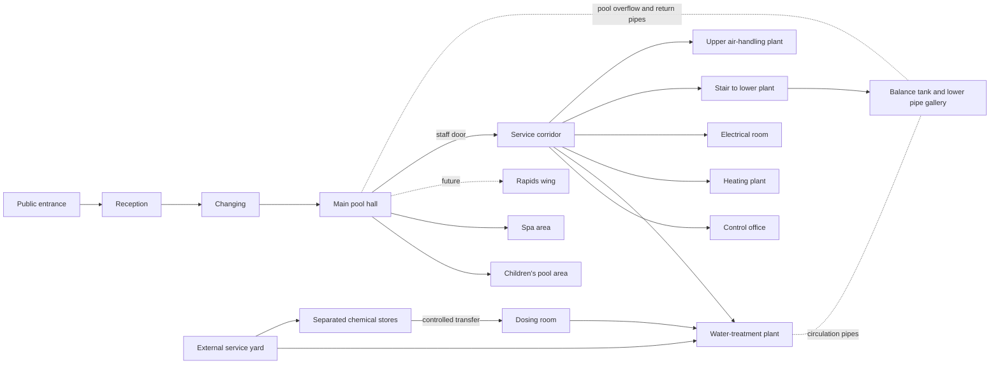

# Pool district: source findings and conceptual layout

This is a planning mock-up, not a surveyed plan, architectural drawing, or decision to build the game. The adjacent [SVG block plan](pool-district-block-plan.svg) shows public and engineering spaces on two levels. Shapes and relative positions are illustrative; no dimensions or equipment clearances have been validated.

## Public references

| Reference                                                                                                                                                                              | What it establishes                                                                                                                                                                                                                                                                                                                                         | Limit                                                                                                                                        |
| -------------------------------------------------------------------------------------------------------------------------------------------------------------------------------------- | ----------------------------------------------------------------------------------------------------------------------------------------------------------------------------------------------------------------------------------------------------------------------------------------------------------------------------------------------------------- | -------------------------------------------------------------------------------------------------------------------------------------------- |
| [Scalloway Pool building information pack](https://www.srt.org.uk/site/assets/files/4997/scalloway_pool_building_information_pack-1.pdf)                                               | A real building with main, toddler and spa pools. The ground-floor plan places a plant room beside the pool hall. A lower plan shows the lower plant room and balance tank. Its room inventory names the circulation pumps, filter, UV, chemical dosing, boilers, upper air-handling unit and separate exterior service access. See PDF pages 2, 19 and 20. | A small 1990s pool, not a model of a modern multi-attraction complex. The plans do not document every pipe route or separate treatment loop. |
| [Sport England six-lane pool plus secondary pool plan](https://sportengland-production-files.s3.eu-west-2.amazonaws.com/s3fs-public/6-lane-pool-plus-pdf-set.pdf)                      | A published reference design places pool-side balance-tank access and a side plant strip beside the hall, with a separate chemical store, basement water-treatment/thermal plant, and mezzanine air-handling plant.                                                                                                                                         | A generic design, not an as-built facility.                                                                                                  |
| [Sport England servicing guidance, Appendix 2](https://sportengland-production-files.s3.eu-west-2.amazonaws.com/s3fs-public/swimming-pools-2013-appendix-2-servicing-the-building.pdf) | Lists the service groups a pool building needs: pool-water treatment, heating, air handling, electrical distribution, drainage and chemical dosing.                                                                                                                                                                                                         | Guidance rather than a site plan; 2013 revision.                                                                                             |
| [London Aquatics Centre Olympic-mode ground-floor plan](https://cdn.archilovers.com/projects/ef0dbf8b-ba23-4ffe-b05b-46826f2dc1cb.pdf)                                                 | Shows the arrangement of competition, diving and training pools and the public/athlete spaces between them.                                                                                                                                                                                                                                                 | Does not identify plant-room locations, so it cannot anchor our engineering layout.                                                          |

## Proposed fictional district

The main hall contains one conventional pool, with a smaller children's pool and spa off the same public circulation route. A rapids wing is reserved as a later extension. These water bodies are distinct equipment groups; this drawing makes no claim that they share treatment circulation. The first simulated circuit would serve the conventional pool only.

The public enters through reception and changing, then reaches the pool hall. Staff use a controlled door from the hall into a dry service corridor. That corridor gives access to a local control office, water plant, heating plant, electrical room and a stair down to lower plant. The water plant has a separate loading route from outside for maintenance. Chemical stores have their own external service access and controlled connection to the dosing room; their location and detailed segregation require a later safety design. The lower level places the balance tank near the pool edge and leaves clear pipe routes back to the treatment plant. Air-handling plant occupies an upper mezzanine or roof zone, reached from the service side.

## Questions to resolve before a dimensioned plan

1. Should the district begin as a compact municipal-style building, like Scalloway, or as one section of a much larger complex?
2. How much of the lower level should the player be able to enter, including the balance-tank access and pipe gallery?
3. Which of the future pools need their own plant rooms, and which can share heating, ventilation or service corridors?
4. What exact maintenance and chemical-handling arrangements are plausible for the selected contemporary equipment? These need equipment and safety references before final placement.

The diagram is intended to make these choices discussable. No game rooms, meshes, controls or simulation have been built from it.
