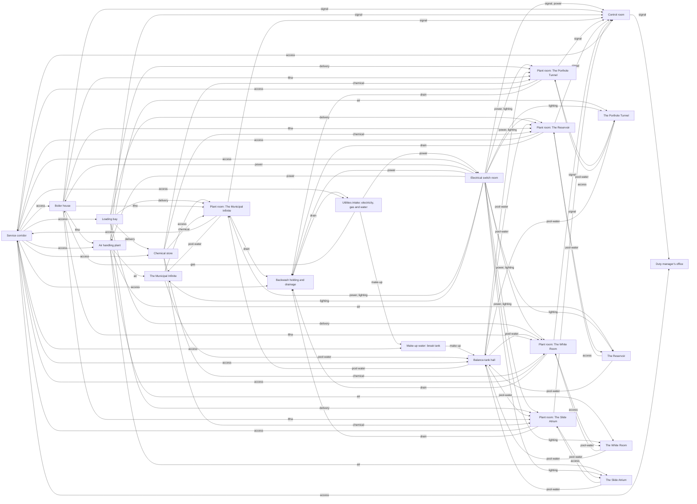

# Plant inventory

Generated from `src/game/plant/inventory.ts` by `inventory-report.ts`: do not edit by hand. Run `UPDATE_INVENTORY=1 npx vp test run scripts/update-plant-inventory.test.ts` to regenerate it after the model changes.

Everything the pool rooms need behind their Authorised Personnel Only doors. Each of the 5 attractions has a plant room of its own, holding the water circuits that serve its pools and features; they share the central infrastructure, joined by a service corridor. The sizes come from the pools themselves, by typical UK practice and rules of thumb: enough to say how much plant there is and where it goes, not a design calculation.

## The water

10 bodies of water, 3,103 m³ in all, with 1,457 m² of surface.

| Water                                 | Use     | Activity | Turnover | Surface m² | Volume m³ | °C  | Evaporation kg/h | Circuit           |
| ------------------------------------- | ------- | -------- | -------- | ---------- | --------- | --- | ---------------- | ----------------- |
| Learner pool, the Municipal Infinite  | learner | calm     | 1 h      | 38         | 23        | 31  | 4.2              | municipal-learner |
| Main pool, the Municipal Infinite     | main    | calm     | 3 h      | 57         | 102       | 28  | 5.7              | municipal-main    |
| Diving pool, the Municipal Infinite   | diving  | calm     | 4 h      | 360        | 935       | 28  | 36.0             | municipal-main    |
| Channel, the Porthole Tunnel          | feature | flowing  | 1 h      | 11         | 3         | 28  | 2.2              | tunnel            |
| Water underfoot, the Porthole Tunnel  | feature | calm     | 1 h      | 38         | 6         | 28  | 3.8              | tunnel            |
| Flooded corridor, the Porthole Tunnel | feature | still    | 1 h      | 43         | 13        | 28  | 2.2              | tunnel            |
| The Reservoir                         | deep    | still    | 3 h      | 800        | 1,600     | 27  | 38.6             | reservoir         |
| Diving pool, the White Room           | diving  | calm     | 4 h      | 79         | 393       | 30  | 8.4              | white             |
| Splash pool 1, the Slide Atrium       | splash  | gushing  | 0.5 h    | 18         | 16        | 30  | 5.6              | atrium            |
| Splash pool 2, the Slide Atrium       | splash  | gushing  | 0.5 h    | 15         | 14        | 30  | 4.8              | atrium            |

## The circuits

Each circuit is one water, treated on its own: balance tank, duty and standby circulation pumps, sand filters (at least two, so one can backwash), ozone where the plant has it, a plate heat exchanger off the heating loop, UV, dosing and sampling, and a pool cleaner.

| Circuit           | Attraction             | Volume m³ | Flow m³/h | Filters | Ozone | Evaporation kg/h | Heat kW | Heat-up kWh | Flume pumps |
| ----------------- | ---------------------- | --------- | --------- | ------- | ----- | ---------------- | ------- | ----------- | ----------- |
| municipal-learner | The Municipal Infinite | 23        | 23        | 2       | no    | 4.2              | 3       | 553         | 0           |
| municipal-main    | The Municipal Infinite | 1,037     | 268       | 3       | yes   | 41.6             | 37      | 21,701      | 0           |
| tunnel            | The Porthole Tunnel    | 22        | 22        | 2       | no    | 8.2              | 7       | 460         | 0           |
| reservoir         | The Reservoir          | 1,600     | 533       | 5       | yes   | 38.6             | 35      | 31,634      | 0           |
| white             | The White Room         | 393       | 98        | 2       | no    | 8.4              | 8       | 9,134       | 0           |
| atrium            | The Slide Atrium       | 29        | 59        | 2       | no    | 29.8             | 21      | 683         | 2           |

Slides: Red slide (red); Yellow slide (yellow); Blue slide (blue) (no pump: it does not run); Blue slide (short) (no pump: it does not run).

## Evaporation

Each body of water loses water to the air in proportion to its temperature and surface, scaled by how agitated it is (still ×0.5, calm ×1, flowing ×2, gushing ×3; `evaporation.ts`), and running slides lose more from their wetted troughs. In all about 131 kg an hour: water the make-up supply must replace, heat the boilers must put back (about 0.68 kWh a kilogram), and moisture the air handling must take back out of the halls.

## Heat lost to the cold world

The pool rooms stand in a cold world: 5 °C outside, the ground at 10 °C. Every surface loses heat in proportion to its area and to the difference across it (Q = U·A·ΔT, `heat-loss.ts`), so the bigger a hall, the more it loses; and the plant must put it back, or the water and the air cool towards the world's temperature. Each hall is kept a degree above its warmest water, and its air handling changes its air 4 times an hour, recovering 60% of the heat.

| Attraction             | Hall °C | Walls m² | Roof m² | Fabric kW | Ventilation kW | Total kW |
| ---------------------- | ------- | -------- | ------- | --------- | -------------- | -------- |
| The Municipal Infinite | 32      | 610      | 1,008   | 20        | 72             | 92       |
| The Porthole Tunnel    | 29      | 870      | 540     | 15        | 22             | 37       |
| The Reservoir          | 28      | 1,392    | 832     | 23        | 121            | 144      |
| The White Room         | 31      | 1,602    | 884     | 29        | 170            | 199      |
| The Slide Atrium       | 31      | 1,292    | 569     | 22        | 109            | 131      |

## Heat

The pools kept warm (evaporation, and conduction through their basins) need about 111 kW, the halls' fabric about 109 kW and their ventilation about 494 kW: 714 kW in all. That is 4 boilers of 300 kW, one of them standby. Heating every pool from cold would take about 64,165 kWh: roughly 3.0 days with every duty boiler firing.

## Where the rooms go

Across, from the middle to the edge: what serves every attraction is central (core), what serves one is peripheral, and what must reach the outside world is on the outer edge. Down, by physics: air handling at the roof; deliveries, chemicals, electrics and staff at the surface; treatment and balance tanks just below the pools, which overflow into their tanks by gravity; boilers and drainage in the basement, drainage lowest. Stairs join every level; a hoist serves every room that takes deliveries (`placement.ts`).

| Room                                         | Ring       | Level     | Serves | Hoist | Why                                                                                                                                       |
| -------------------------------------------- | ---------- | --------- | ------ | ----- | ----------------------------------------------------------------------------------------------------------------------------------------- |
| Service corridor                             | core       | treatment | 5      | no    | it joins the attractions’ plant rooms, all at this level                                                                                  |
| Boiler house                                 | core       | basement  | 5      | no    | its heat rises to everything it serves, and its flue climbs to the roof                                                                   |
| Utilities intake: electricity, gas and water | outer      | surface   | 5      | no    | every utility comes in at the boundary, in one room: the 800 A isolator, the main gas valve and the stopcock shut the whole facility down |
| Electrical switch room                       | core       | surface   | 5      | no    | electrics are kept above the wet plant, out of the way of leaks and floods                                                                |
| Loading bay                                  | outer      | surface   | 5      | no    | deliveries arrive by road                                                                                                                 |
| Chemical store                               | core       | surface   | 5      | yes   | by the loading bay, and never in a basement: chlorine is heavier than air                                                                 |
| Balance-tank hall                            | core       | treatment | 5      | no    | just below the pools, which overflow into their tanks by gravity                                                                          |
| Make-up water: break tank                    | outer      | surface   | 5      | no    | its break tank, fed from the water main, feeds the balance tanks below by gravity                                                         |
| Backwash holding and drainage                | core       | basement  | 5      | no    | lowest of all: everything drains to it                                                                                                    |
| Air handling plant                           | outer      | roof      | 5      | no    | it takes fresh air in and lets stale air out                                                                                              |
| Control room                                 | core       | surface   | 5      | no    | staff work here, by the pool rooms                                                                                                        |
| Duty manager’s office                        | core       | surface   | 5      | no    | staff work here                                                                                                                           |
| Plant room: The Municipal Infinite           | peripheral | treatment | 1      | yes   | by its own pool room, just below its pools, so its pipes are short and its pumps draw from its tank at their level                        |
| Plant room: The Porthole Tunnel              | peripheral | treatment | 1      | yes   | by its own pool room, just below its pools, so its pipes are short and its pumps draw from its tank at their level                        |
| Plant room: The Reservoir                    | peripheral | treatment | 1      | yes   | by its own pool room, just below its pools, so its pipes are short and its pumps draw from its tank at their level                        |
| Plant room: The White Room                   | peripheral | treatment | 1      | yes   | by its own pool room, just below its pools, so its pipes are short and its pumps draw from its tank at their level                        |
| Plant room: The Slide Atrium                 | peripheral | treatment | 1      | yes   | by its own pool room, just below its pools, so its pipes are short and its pumps draw from its tank at their level                        |

## Is there room enough?

Each room laid out in `warren-plan.ts` against the floor its equipment needs (`capacity.ts`): every piece of equipment takes an allowance for its footprint and the access round it, and each balance tank is sized for its pool. A room should use no more than 85% of its floor, leaving room to work and to bring in a replacement.

| Room                                         | Needs m² | Has m² | Used | Height m |
| -------------------------------------------- | -------- | ------ | ---- | -------- |
| Balance-tank hall                            | 111      | 384    | 29%  | 9.5      |
| Service corridor                             | 0        | 276    | 0%   | 3        |
| Plant room: The Reservoir                    | 111      | 264    | 42%  | 6        |
| Plant room: The Municipal Infinite           | 133      | 352    | 38%  | 4.5      |
| Plant room: The Slide Atrium                 | 64       | 196    | 33%  | 4.5      |
| Plant room: The White Room                   | 54       | 120    | 45%  | 4.5      |
| Plant room: The Porthole Tunnel              | 54       | 80     | 68%  | 3.5      |
| Boiler house                                 | 40       | 408    | 10%  | 7.5      |
| Backwash holding and drainage                | 30       | 156    | 19%  | 4.5      |
| Control room                                 | 12       | 120    | 10%  | 4        |
| Duty manager’s office                        | 8        | 64     | 13%  | 2.7      |
| Utilities intake: electricity, gas and water | 20       | 60     | 33%  | 3.5      |
| Make-up water: break tank                    | 12       | 60     | 20%  | 4        |
| Loading bay                                  | 74       | 336    | 22%  | 6        |
| Chemical store                               | 28       | 120    | 23%  | 4        |
| Electrical switch room                       | 38       | 120    | 32%  | 4        |
| Air handling plant                           | 225      | 600    | 38%  | 30       |

## The rooms and their equipment

### Service corridor

- (a way through)

### Boiler house

- Boiler 1 (300 kW)
- Boiler 2 (300 kW)
- Boiler 3 (300 kW)
- Boiler 4 (300 kW)
- Low-loss header and LTHW pumps

### Utilities intake: electricity, gas and water

- Gas meter, governor and main gas inlet valve
- Incoming supply: 800 A main isolator and meter
- Water main: stopcock and meter
- Sewer connection: trade effluent meter and non-return valve

### Electrical switch room

- LV main switchboard
- Lighting control panel: contactors, time clocks, switching
- Emergency lighting central battery and changeover
- UPS for the control room

### Loading bay

- Goods-in door, dock leveller and pallet truck
- Delivery log and order book
- Spares cage

### Chemical store

- Bulk sodium hypochlorite tank
- Bulk acid tank (and CO₂ bottles)

### Balance-tank hall

- Balance tank: municipal-learner
- Balance tank: municipal-main
- Balance tank: tunnel
- Balance tank: reservoir
- Balance tank: white
- Balance tank: atrium

### Make-up water: break tank

- Break tank

### Backwash holding and drainage

- Backwash holding tank and pumping station

### Air handling plant

- Air handling unit: The Municipal Infinite
- Air handling unit: The Porthole Tunnel
- Air handling unit: The Reservoir
- Air handling unit: The White Room
- Air handling unit: The Slide Atrium

### Control room

- BMS outstation, mimics and annunciator

### Duty manager’s office

- Duty manager’s desk, logbook and test kit

### Plant room: The Municipal Infinite

- Motor control centre and local panel: The Municipal Infinite
- Circulation pumps, duty and standby: municipal-learner (23 m³/h, 1.4 kW each)
- Sand filters × 2: municipal-learner
- Plate heat exchanger: municipal-learner (3 kW)
- UV unit: municipal-learner
- Dosing and sampling: municipal-learner
- Pool cleaner and vacuum points: municipal-learner
- Circulation pumps, duty and standby: municipal-main (268 m³/h, 16.8 kW each)
- Sand filters × 3: municipal-main
- Ozone plant: municipal-main
- Plate heat exchanger: municipal-main (37 kW)
- UV unit: municipal-main
- Dosing and sampling: municipal-main
- Pool cleaner and vacuum points: municipal-main

### Plant room: The Porthole Tunnel

- Motor control centre and local panel: The Porthole Tunnel
- Circulation pumps, duty and standby: tunnel (22 m³/h, 1.4 kW each)
- Sand filters × 2: tunnel
- Plate heat exchanger: tunnel (7 kW)
- UV unit: tunnel
- Dosing and sampling: tunnel
- Pool cleaner and vacuum points: tunnel

### Plant room: The Reservoir

- Motor control centre and local panel: The Reservoir
- Circulation pumps, duty and standby: reservoir (533 m³/h, 33.5 kW each)
- Sand filters × 5: reservoir
- Ozone plant: reservoir
- Plate heat exchanger: reservoir (35 kW)
- UV unit: reservoir
- Dosing and sampling: reservoir
- Pool cleaner and vacuum points: reservoir

### Plant room: The White Room

- Motor control centre and local panel: The White Room
- Circulation pumps, duty and standby: white (98 m³/h, 6.2 kW each)
- Sand filters × 2: white
- Plate heat exchanger: white (8 kW)
- UV unit: white
- Dosing and sampling: white
- Pool cleaner and vacuum points: white

### Plant room: The Slide Atrium

- Motor control centre and local panel: The Slide Atrium
- Circulation pumps, duty and standby: atrium (59 m³/h, 3.7 kW each)
- Sand filters × 2: atrium
- Plate heat exchanger: atrium (21 kW)
- UV unit: atrium
- Dosing and sampling: atrium
- Pool cleaner and vacuum points: atrium
- Flume pump: Red slide (red) (80 m³/h)
- Flume pump: Yellow slide (yellow) (80 m³/h)

## The map

Rooms (attractions on the pool-room side, plant rooms and shared rooms on the plant side) and what runs between them.

In all: 110 nodes (78 pieces of equipment in 17 rooms) and 220 connections. The shared rooms: Service corridor, Boiler house, Utilities intake: electricity, gas and water, Electrical switch room, Loading bay, Chemical store, Balance-tank hall, Make-up water: break tank, Backwash holding and drainage, Air handling plant, Control room, Duty manager’s office.
