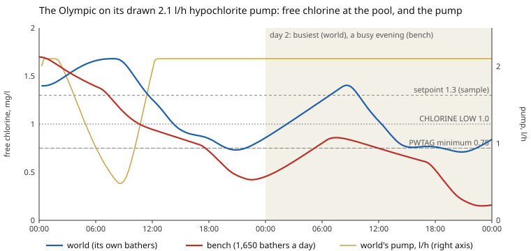

# 101: The water-chemistry model in the world

Status: stage 1 done 2026-10-28 (see "What was done" below); later stages not started.

You are working on "The Pool", a browser game in TypeScript and Three.js simulating a leisure centre's pool plant (this repository). Read `CLAUDE.md` first; its rules apply, above all that the game has one world state (`src/game/world.ts`, `WORLD_VERSION` with a migration for every change of shape) and that status words need a failure model. Then read `doc/research/pool-dosing-and-water-chemistry.md` (with the owner's answers in its §11), `doc/research/water-chemistry-models.md` (the model, its bench, and the pool's mixing lag in its §5.1), and the model itself: `src/game/water/pool-chemistry.ts`, `circuit.ts` and `chemistry-bench.ts` with their tests. Markdown is one paragraph per line.

## The request

The owner, 2026-10-28, after the bench: "Let's do that and then see if you can integrate the new water model into the game." ("That" was the pool's mixing lag, done first: `water-chemistry-models.md` §5.1.) Decisions already made by the owner the same day:

- The displays and alarms read the true water for now: the sensors are ideal ("For now, let's cheat").
- The full chemistry set is used.
- Two zones a circuit, the pool and its balance tank; the pool with its mixing lag (three cells in series), so a dose into the tank takes about a turnover to show fully in the pool.
- The controller doses into the return; hand doses go into the balance tank; the sample is taken from the tank's water (the pumps' suction).
- The Olympic keeps its drawn, undersized hypochlorite pump (a DMX 1602, 2.1 l/h, where the bench says about 12.5 l/h is needed): the controller is capped at the pump's real maximum, and how it goes wrong is observed and recorded as the "before" picture for a new, larger pump another agent is designing.

## Stage 1: the model installed (2026-10-28)

1. **The world state.** Each pool's circuit carries the model's state, its balance tank and its pool's three cells (`PoolChemistry` each), replacing the ease-towards-target chlorine and pH of `stepPoolsWater` (`src/game/plant/pools.ts`). Each pool's pH, free and combined chlorine and redox are derived from the model (the pool's far side, as bathers meet it and a poolside test reads it), so every display, mimic, annunciator window, controller readout and the bridge keep reading the same `world.pools[id]` fields. `WORLD_VERSION` bumped, with a migration that fills nominal water from each pool's present readings.
2. **The flows** between the zones are those the world already models: the circulation (its actual flow), overflow and main drains into the tank, make-up into the tank at the mains' composition, backwash and drain-down to waste, evaporation from the pool, a spa's filter washes.
3. **Dosing.** A closed loop per pool after the bench's controller: PI for chlorine, P for pH, with the pH lockout of chlorine (DEPOLOX: setpoint ± 0.4), reading the true water of the tank through the sample cell's 60 s lag. Its outputs set each dosing pump's rate in litres per hour, capped at the drawn pump's maximum (the Olympic's and the lounge's DMX 1602, 2.1 l/h; their DDS acid pumps, 7.5 l/h; the spa cabinets' peristaltic heads at the bench's rates). It doses only while the day tank has stock and its path is open (`pool-dosing.ts`'s valve interlocks kept), and only while the water circulates (the flow interlock). The day tanks are drawn down by the litres actually pumped, at fixed strengths for now (14 %, 140 g/l available chlorine; 10 % acid, 104.8 g/l HCl), replacing `DOSE_PER_M3_DAY`'s fixed draw.
4. **Bathers** drive chlorine demand from `world.bathers` as the model's inputs do; the footbath's waders count as a small share of a bather each.
5. **The displays.** The dosing pumps' displays (the DMX and DDS boards, the spa cabinets' peristaltic heads, the DoseCell heads) show the real rate and run while their pump runs, not the fixed 1.24 and 0.62 l/h they showed, nor the bulk store's stock.
6. **Time and cost.** The chemistry is stepped on its own clock, every 10 s of world time, the hydraulics' flows summed between; stable at the world's 0.1 s steps and at the larger steps of time acceleration (mission 059's up to 10 s), tested.
7. **Check in the browser** that each pool settles at sensible values (free chlorine about 1–1.5 mg/l, pH 7.2–7.4), that the pumps' displays move with the controller, that stopping circulation or shutting a day tank's outlet stops dosing and lets chlorine fall, and that alarms fire as before; watch at speed too.
8. **The Olympic's undersized pump**, run on the bench and in the world over a normal day and a busy evening: when the pump pins at 100 %, when free chlorine sags below setpoint, combined chlorine and pH, which alarms fire, and how long until the pool is out of PWTAG's range. Recorded below as the "before" picture.

## Later stages (not tonight)

- **Strength per tank**: hypochlorite strength held in each store and day tank, mixed by mass on transfer, so a weak or strong delivery changes what a litre does (`pool-dosing-and-water-chemistry.md` §7.2).
- **Deliveries and decay**: a strength and a certificate with each delivery, hypochlorite decaying with the rooms' temperatures (its §2.8, §7.3), chlorate building in the stock.
- **The hydrometer** at the fill cabinet, to check a delivery's strength.
- **Hand dosing at every balance tank** (TODO "Hand dosing at every balance tank"): a hatch, the store's sacks, a scale, `pool/hand-dose` into the tank zone.
- **A working test kit**: DPD 1 and 3, phenol red, and later alkalinity, hardness and TDS, reading the pool's far side through each test's resolution, with its log sheet.
- **Sensors that drift**: the controller reading its probes (`sampling.ts`'s blocks) instead of the true water, with zero drift, fouling and failure as state, the daily calibration against the player's own DPD; the controller's maximum dosing time (latched, with its reset), feed delay, sample-flow interlock and two limit alarms each; the displays and alarms then reading the controller.
- **Units on the OT-216 terminals**: litres, kg or mol (its §7.7).
- **The pumps' own keys** (STOP, MANUAL, their manual rate) honoured by the world, so stopping a pump at its keys stops its dosing (the TODO from prompt 089).
- **The hall's trichloramine** in its air, and the air handling's part in it (`water-chemistry-models.md` §10, item 8).

## Questions for the owner (one at a time, in this order)

1. **The jacuzzi's setpoint, and its combined chlorine.** HSG282 holds a spa at 3 to 5 mg/l free chlorine, and the bench at 4; the game's CHLORINE HIGH window and health check are at 3 mg/l for every pool, so stage 1 holds the jacuzzi at the same 1.3 mg/l sample setpoint as the others. There its free chlorine swings 1.0 to 2.1 mg/l with a few bathers and its combined chlorine reaches 1.1 mg/l at busy times, over PWTAG's 1.0. Raise it, with its own alarm limits?
2. **Organic chloramine calibration** (`water-chemistry-models.md` §11, question 2): the invented constants set steady combined chlorine at 0.06 to 0.33 mg/l; calibrate, or accept as the game's choice?
3. **CO₂ loss** (its question 3): Wojtowicz's constant drains alkalinity to 50–70 mg/l (17 in the footbath) over months; calibrate against real UK acid use, or cap the turnover term?
4. **Thiosulphate's chemistry** (its question 4): PWTAG's dose (mostly tetrathionate, pH rising after dechlorination) or the sulphate stoichiometry.
5. **Soft or hard mains** (its question 5): stage 1 uses the bench's moderately hard supply (hardness 200, alkalinity 150, pH 7.6).
6. **An Olympic third zone** (its question 7): a deep end exchanging slowly with the rest.
7. **The slower chlorine loop** (its question 8): tuned to the mixing lag's dead time, it overshoots a setpoint step; acceptable?
8. **The peristaltic pumps' rates**: the spa cabinets' heads are unspecified (`sizing.ts`); stage 1 uses the bench's 0.5 l/h (jacuzzi) and 0.1 l/h (footbath). Real small spa controllers' heads give about 1.5 l/h; which model?
9. **The rest of the research questions** (`pool-dosing-and-water-chemistry.md` §11, questions 3 to 12) still stand: strength's unit, the test kit, the OT-216 units, deliveries, decay, the controller's form, the store's hand chemicals, coagulant.

## What was done (2026-10-28, stage 1)

**The mixing lag first** (its own commit): the pool zone as three cells in series, `src/game/water/circuit.ts`; the bench rerun with all ten scenarios passing and the note's figures redone (`water-chemistry-models.md` §5.1, §7).

**Installed.** `src/game/plant/water-treatment.ts` (pure, tested in `water-treatment.test.ts` and `water-treatment.slow.test.ts`): each pool's circuit (`world.treatment.circuits[id]`: its tank, its pool's three cells, its controller) and what has happened since its chemistry last stepped (`pending`), stepped every 10 s of world time with the step's flows and doses summed between. `world.ts` steps it after the hydraulics (`stepPoolsWater` now reports each pool's make-up, evaporation and whether its UV or ozone is lit, and no longer touches pH or chlorine) and writes each pool's pH, free and combined chlorine and redox from its far cell (`withWaterReadings`), so every display, annunciator, mimic and the bridge read the same fields as before. `WORLD_VERSION` 58: migration 57 fills each circuit from the pool's present readings with its settled water (`SETTLED`: each pool's alkalinity, hardness, TDS, sulphate and chlorate, and its controller's integral, from the bench's 120-day steady state with the world's pumps and controller; checked by the slow test). A first cut filled nominal water at alkalinity 120: the footbath, which degasses fastest, ran its pH up 0.2 in half a minute, so a working pool starts from its own settled water.

**Dosing.** The controller (`stepControl`): PI on free chlorine (setpoint 1.3 mg/l at the sample, band 0.5 mg/l, integral 6 h, the bench's tuning for the lag's dead time), P on pH (7.3, band 0.3), the pH lockout of chlorine (± 0.4), the sample cell's 60 s lag, its integral held while it cannot dose; sensors ideal. **`pumpRates()` is the one place a pump's delivered litres an hour are worked out**, from the controller's output and the dosing permissives (`dosedByPool`: circulating, the room's chemical service, the day tank's stock and open path); the day tanks are drawn by those delivered litres (`pumpDraw`), the water dosed by the same litres at 140 g/l and 104.8 g/l, `DOSE_PER_M3_DAY` kept only for the schematics' days-left estimate, `doseDraw` and `phTarget` gone. **The pump family plugs in there** (mission 102): its real pump models replace the cap at `DOSING_PUMPS`' rating inside `pumpRates()`, and a pump that delivers less than asked (gas-locked, worn) then shows in the chemistry, since both the draw and the dose follow what it delivers. `pool-dosing.ts`'s `doseRates` and `doseDemand` read the same function, so the DoseCell heads show the real rate; the DMX and DDS boards (`room-equipment.ts`) are asked for it and run only while their pump doses; the spa cabinets' peristaltic heads turn only while dosing, at a speed in proportion to their rate.

**Bathers** from `world.bathers.pools[id].now`, each cell its share; the footbath's waders at 0.003 of a bather each (invented, the bench's six bather-equivalents a day over about 2,000 waders). Make-up at the bench's moderately hard mains.

**Settled readings in the world** (a new game, its first two days; then checked in the browser on its own save slot, `?slot=chem101`):

| Pool     | Free chlorine, mg/l  | Combined   | pH        | Hypochlorite pump            | Acid pump      | Bench's daily use (hypo, acid) |
| -------- | -------------------- | ---------- | --------- | ---------------------------- | -------------- | ------------------------------ |
| Lounge   | 1.33–1.70            | 0.02–0.36  | 7.29–7.33 | 0–0.7 l/h of 2.1             | 0.1–0.6 of 7.5 | 12.9, 8.8 l                    |
| Olympic  | sags to 0.71 (below) | 0.05–0.15  | 7.35–7.40 | pinned at 2.10 from 12:30    | 1.1–2.3 of 7.5 | 50.4 (capped), 33.0 l          |
| Jacuzzi  | 0.95–2.13            | up to 1.15 | 7.28–7.45 | 0–0.5 l/h of 0.5 (pins busy) | to 0.06 of 0.5 | 1.6, 1.3 l                     |
| Footbath | 1.38–1.53            | 0–0.17     | 7.31–7.35 | 0.01–0.02 of 0.1             | to 0.1 of 0.1  | 0.3, 0.2 l                     |

**Checked in the browser** (http://127.0.0.1:5175, a slot of its own): two days of world by the console's `time/skip`, readings as above; the Olympic's duty pump DP-101A reading RUN 2.10 l/h, AUTO 100 %, 180 strokes a minute, its standby PAUSE; its panel's emergency stop struck, the display at once PAUSE 0.00, AUTO 0 %; the lounge's circulation stopped (both pumps' rates 0 at once, its chlorine falling 1.40 to 1.27 in three hours); its hypochlorite day tank's outlet shut (asked 1.66 l/h, given none, the tank's 198.705 l unchanged, chlorine 1.32 to 0.67 in two hours with CHLORINE LOW lit); CHLORINE LOW lighting on the Olympic as it sagged; no console errors. Time acceleration (mission 059) is not built, so speed was tried by `time/skip` (9 h of world in 3.9 s) and in the tests: the same six hours at world steps of 1, 10 and 60 s agree within 0.1 mg/l and 0.02 pH.

**Tests whose expected numbers the model rightly changed:** `world.test.ts`'s two dosing tests (a dry acid store now lets pH creep up by CO₂ loss, the lounge past 7.5 in 13 h, every pool rising, where the Olympic had been set to pass 7.5; and with the hypochlorite gone the acid controller holds pH at 7.2–7.45 instead of driving it to 6.5, while every pool's chlorine falls below 1.0 in 12 h); `new-game.test.ts` (pH held near the 7.3 setpoint, 7.2–7.45, not 7.4 ± 0.05); `world.slow.test.ts` (with the hypochlorite gone the lounge's chlorine falls at its bathers' demand, about 0.1 mg/l an hour, not the old fixed 0.36, so fewer than 0.6 of the usual bathers come in six hours, not 0.5; and a 20 s timeout for the lights test, a day and a half of world); `pools.test.ts` (the chloramines' build-up without UV moved to `water-treatment.test.ts`; the pools now only say whether the UV is lit); `pool-dosing.test.ts` (the footbath set a little short of chlorine so its controller asks); `lounge-injection.test.ts` (an hour in 10 s steps, as the world runs, not one 3,600 s step); `save.test.ts` (the new field); the bench's game-pools test (the Olympic below 1 mg/l with its pump pinned, its own pool's drawn pumps throughout).

## The Olympic's undersized pump: the before picture

Made by `OLYMPIC_BEFORE=1 npx vp test run scripts/olympic-before.test.ts` (CSVs and the chart to `build/reports/olympic-before.*`). The world: a new game from midnight, two days, the second drawn as busy as a day can be (busyness 1.3, at most 156 bathers in the water). The bench: its pool healthy on a 12.5 l/h pump, then the drawn 2.1 l/h from midnight, at its heavier 1,650 bathers a day, the second evening busier by half.

| What                                   | World                                                                       | Bench                                                      |
| -------------------------------------- | --------------------------------------------------------------------------- | ---------------------------------------------------------- |
| The pump pinned at 100 %               | from 12:30 on day 1, for good (35 h and counting)                           | from 10:15 on day 1, for good                              |
| Free chlorine below its 1.3 setpoint   | from 11:45 day 1; 33.5 h of the 48                                          | from 07:30 day 1; 41 h                                     |
| Below 1.0 (CHLORINE LOW)               | from 14:30 day 1; 23.75 h of the 48, lit through each evening and night     | from 10:45 day 1; 37.5 h                                   |
| Below 0.75 (PWTAG's minimum, CoP §9.5) | from 20:00 day 1; 5.75 h (evenings, lowest 0.73 day 1, 0.71 day 2 at 20:45) | from 17:45 day 1; 23.75 h; lowest 0.42 day 1, 0.15 day 2   |
| Recovery overnight                     | to 1.39 by 08:00, never back to setpoint                                    | to 0.86 by 07:00                                           |
| Combined chlorine                      | rises with the sag, 0.05 to 0.15 mg/l: within PWTAG's 1.0                   | to 0.20 mg/l                                               |
| pH                                     | steady, 7.35–7.40: the acid pump keeps up                                   | steady, 7.35–7.37                                          |
| Alarms                                 | CHLORINE LOW (`cl-low`) only; no DOSING INHIBITED, no pH alarm              | —                                                          |
| Steady state (bench, 120 days)         | —                                                                           | 0.26 mg/l (0.12–0.40), the pump at 100 % all day and night |

The maximum dosing time is not modelled in the world yet (a later stage): with `sampling.ts`'s 30-minute limit it would have latched at about 13:00 on day 1 and stopped the pump altogether; DEPOLOX's longest, 10 h, at about 22:30. Either way it is the alarm a real plant would raise for this fault, the pump at full for hours without effect.
